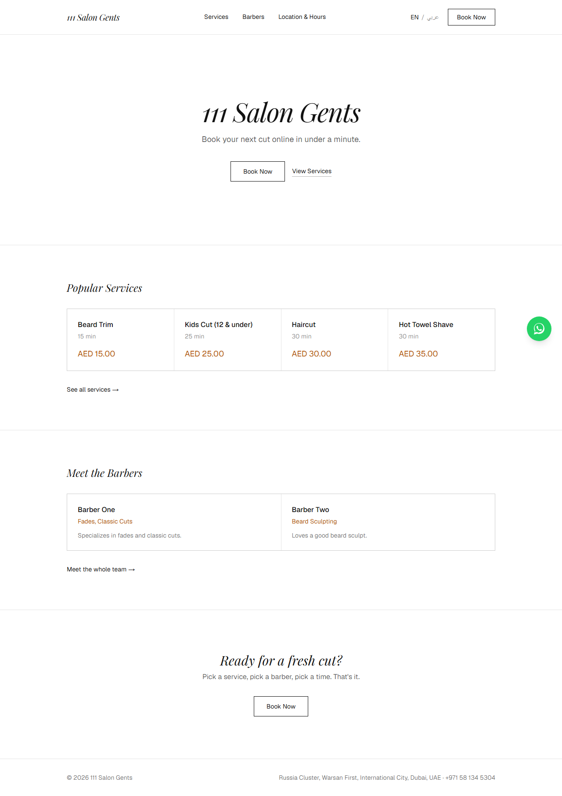
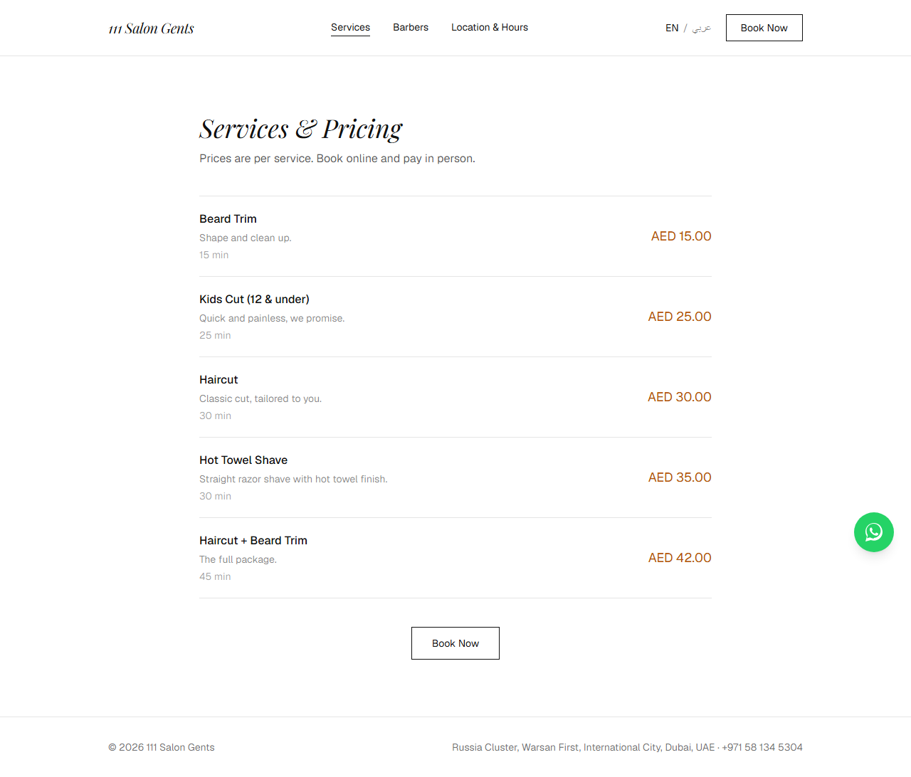
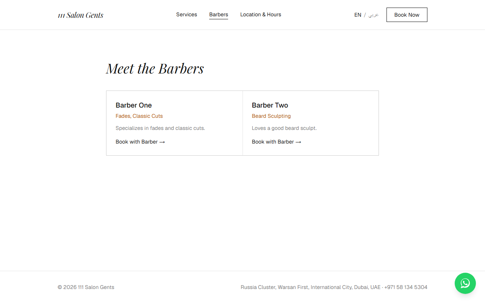
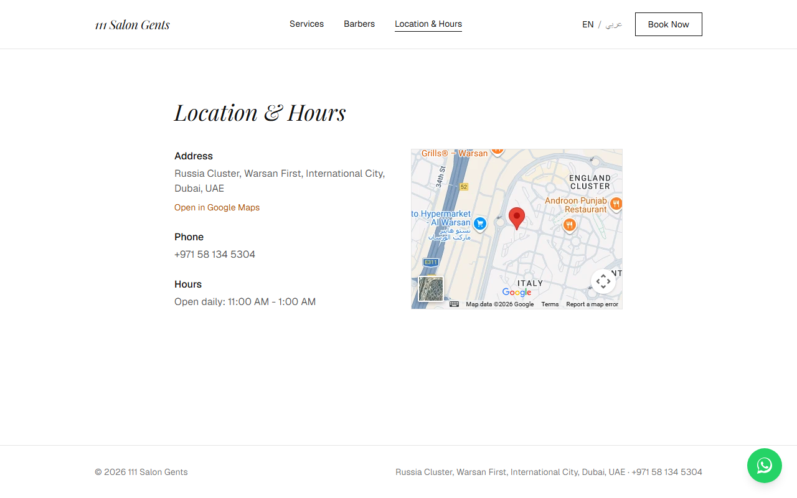
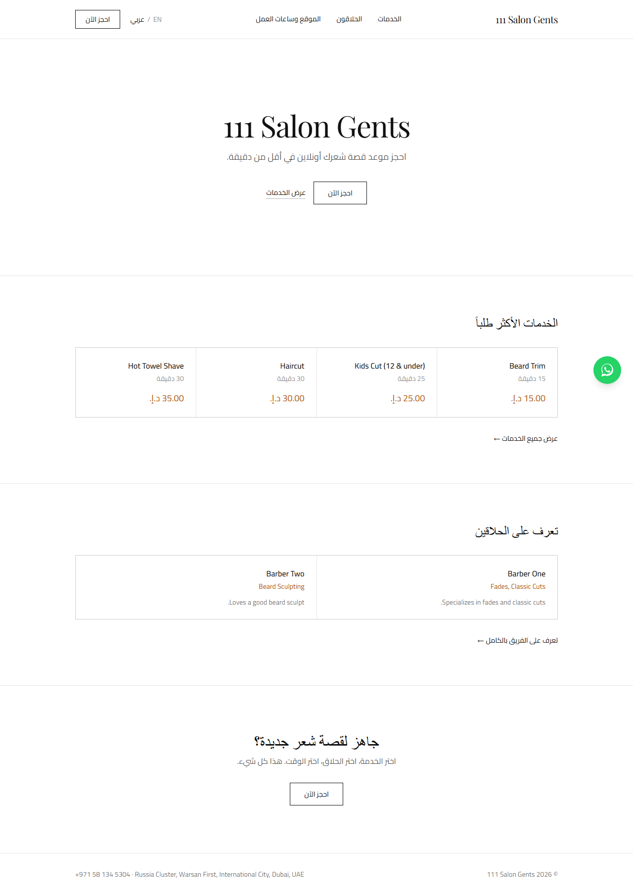
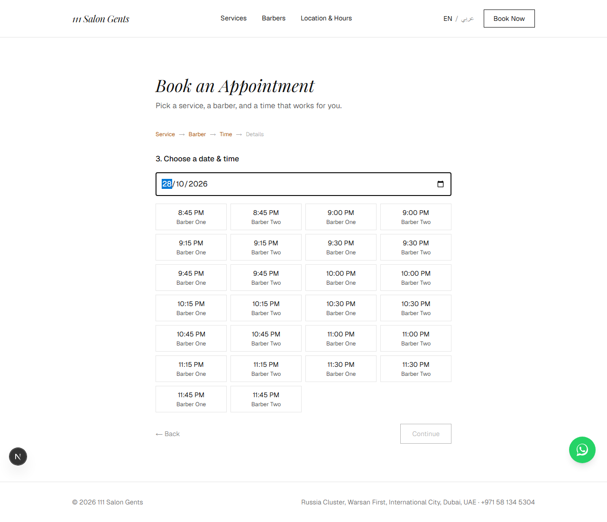
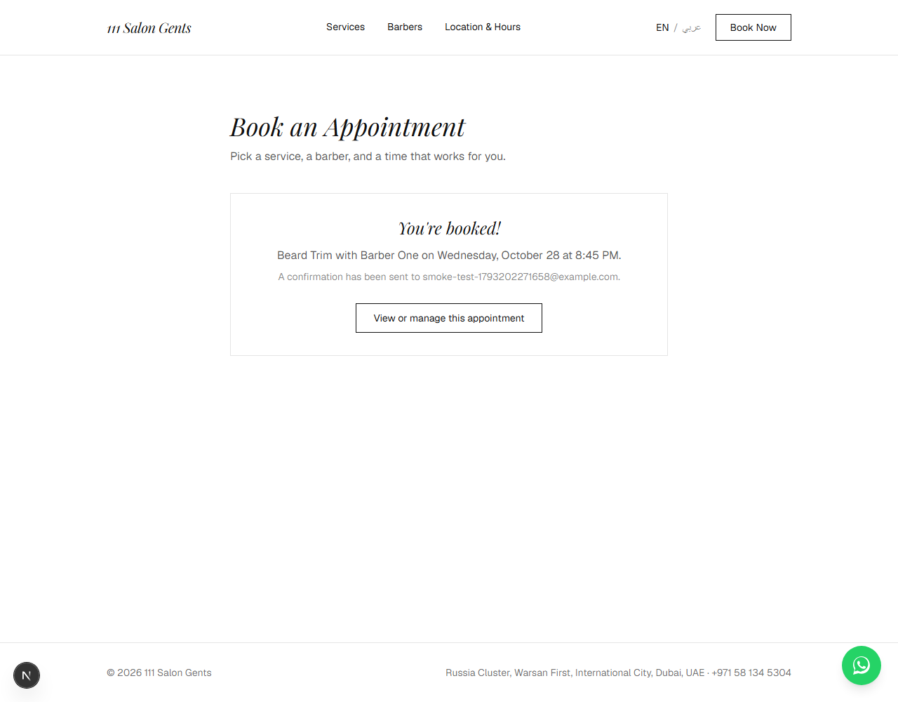
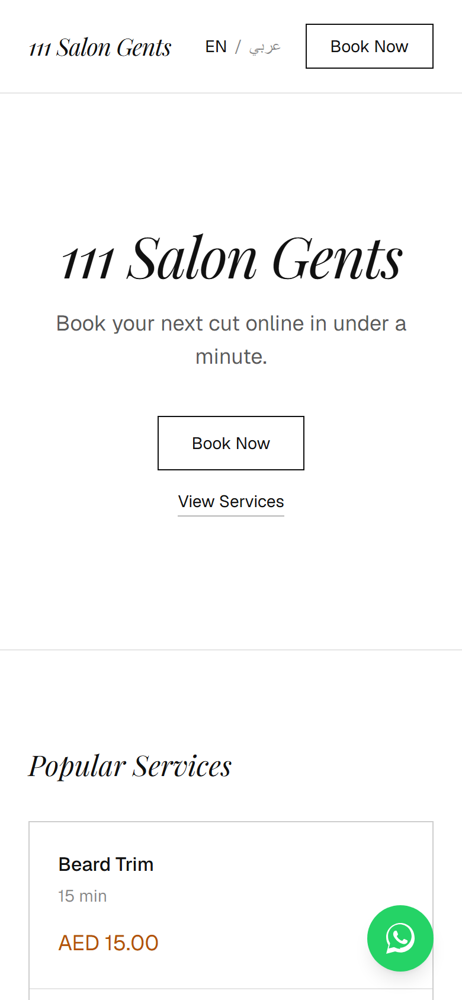
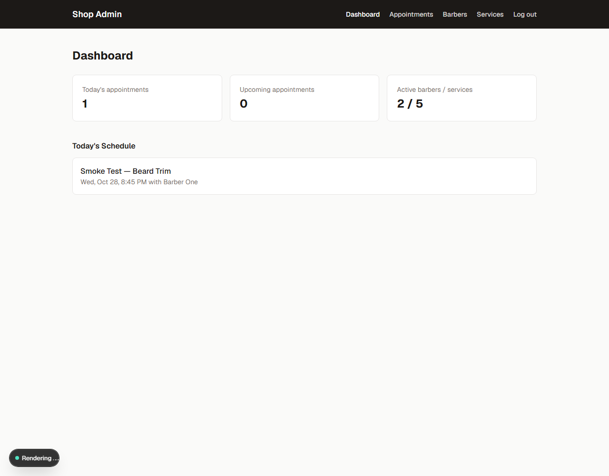
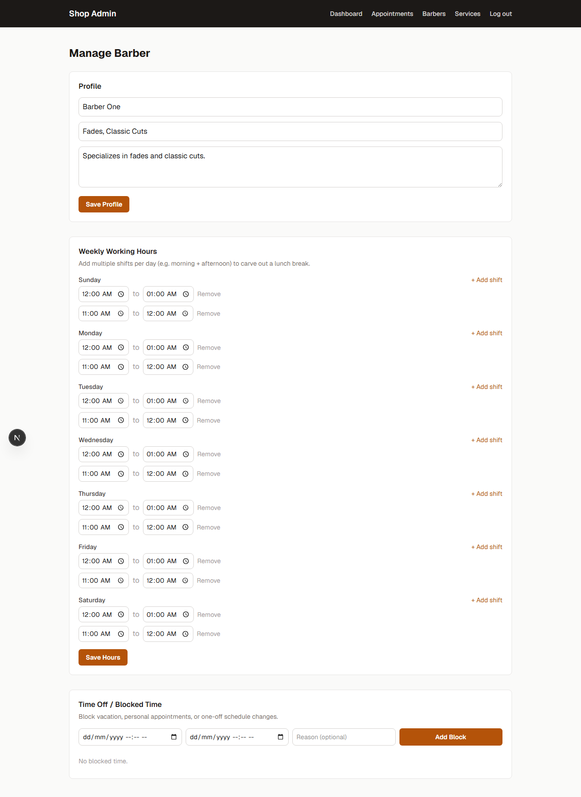

# 111 Salon Gents — Booking App

A booking site for [111 Salon Gents](https://maps.app.goo.gl/hzRgDXJkC7zNaNux9)
(صالون حلاقة رجالي 111), a men's barbershop in International City, Dubai, UAE,
with multiple barbers each on their own schedule. Clients book online and pay
in person; there's an admin dashboard for managing appointments, barbers,
services, and schedules. The public site is bilingual (English/Arabic) with
full RTL layout support; the admin dashboard is English-only.



## The shop

Details below come from the shop's Google Maps listing, as shown on its
[Yalah directory page](https://yalah.ae/barber-shops/111-salon-gents-international-city).

| | |
|---|---|
| **Address** | Russia Cluster, Warsan First, International City, Dubai, UAE |
| **Map pin** | 25.170763, 55.39987 ([Google Maps](https://www.google.com/maps/search/?api=1&query=111+salon+gents&query_place_id=ChIJ5bHK6z5nXz4RWoYHp4ShC1U)) |
| **Phone / WhatsApp** | +971 58 134 5304 |
| **Hours** | Open daily, 11:00 AM – 1:00 AM |
| **Rating** | 5.0 / 5 from 12 Google reviews ("Excellent service", "Good value for money", "Clean and well-maintained") |
| **Good to know** | Good for kids · NFC mobile payments · Parking nearby (free and paid) |

## Screenshots

### Public site

| Services & pricing | Barbers |
|---|---|
|  |  |

| Location & hours | Arabic (RTL) |
|---|---|
|  |  |

The contact page pins the map to the shop's exact coordinates, links to its
Google Maps listing, and makes the phone number tappable.

### Booking flow

| Pick a time | Confirmation |
|---|---|
|  |  |

### WhatsApp button



A floating WhatsApp button sits in the bottom-right corner of every public
page (in both languages) and opens a chat with the shop at
`wa.me/971581345304` (`src/components/WhatsAppButton.tsx`).

### Admin dashboard

| Dashboard | Barber schedule editor |
|---|---|
|  |  |

## Stack

- **Next.js 16** (App Router, TypeScript) + Tailwind CSS
- **Prisma 6** + **SQLite** for local dev (see "Moving to Postgres" below)
- Custom cookie-based admin auth (`jose` + `bcryptjs`) — no third-party auth service
- `zod` for input validation, `date-fns` for date math
- Custom lightweight i18n (`src/lib/i18n/`) — no external library

## Getting started

```bash
npm install
npm run db:seed   # creates the SQLite db, seeds shop info/services/barbers/admin user
npm run dev       # http://localhost:3000
```

Admin login is at `/admin/login`. Seeded credentials come from `.env`
(`ADMIN_EMAIL` / `ADMIN_PASSWORD`), defaulting to:

```
admin@example.com / ChangeMe123!
```

Change these in `.env` before running the seed script for anything beyond
local dev.

Shop name, address and phone are read from `.env` (`SHOP_NAME`,
`SHOP_ADDRESS`, `SHOP_PHONE`, `SHOP_EMAIL`) by the seed script. Re-running
`npm run db:seed` is safe: it updates the shop info and the seeded barbers'
hours, and leaves services and appointments alone.

## Real-shop info still needed

The listing above filled in the address, phone, hours and map pin. These are
still placeholders:

- **Barber names/bios** — seeded as "Barber One" / "Barber Two". Edit them
  under `/admin/barbers`.
- **Services and prices** — seeded with estimated AED prices; the listing
  doesn't include a price list. Edit them under `/admin/services`.
- **Email** (`SHOP_EMAIL`) — none is listed, so the site omits it until set.
- **About text** — the homepage uses a generic translated tagline until
  `aboutText` is set.

## How booking works

- `src/lib/availability.ts` computes open slots for a barber/day by taking
  their recurring weekly shifts (`WorkingHour`), subtracting one-off blocks
  (`TimeOff`) and existing appointments, and stepping through in 15-minute
  increments. A barber can have multiple shifts on the same day (e.g.
  9–12 and 1–6) to model a lunch break.
- **Late-night hours**: a shift can't cross midnight, so the shop's
  11 AM – 1 AM day is stored as two shifts per weekday: 11:00 – 24:00, plus
  00:00 – 01:00 for the end of the previous night (see `shopWeekShifts()` in
  `prisma/seed.ts`). In the admin hours editor, an end time of 12:00 AM means
  midnight. One consequence: a single appointment can't span midnight (e.g.
  a 30-minute cut can start at 11:30 PM, but not 11:45 PM).
- Booking requires at least 60 minutes' notice and can be made up to 30 days
  out (`MIN_BOOKING_NOTICE_MINUTES` / `MAX_BOOKING_DAYS_AHEAD` in that file).
  Admin-created appointments skip the notice requirement.
- Each appointment gets a random, unguessable `manageToken` used for the
  client-facing "view/cancel/reschedule" link — there's no client account
  system, just that link (sent by email at booking time).
- **Timezone**: all business-hours math uses JS `Date`'s server-local-time
  behavior rather than an explicit IANA zone. `src/instrumentation.ts` pins
  `process.env.TZ = "Asia/Dubai"` at server startup so this is correct
  regardless of what timezone the host defaults to (most default to UTC).
  If this app is ever reused for a shop in another timezone, update that
  file.

## Bilingual (English/Arabic) support

- `src/lib/i18n/dictionaries.ts` holds every UI string in both languages.
  Server components call `getDictionary()` (`src/lib/i18n/server.ts`);
  client components use the `useLocale()` hook
  (`src/components/LocaleProvider.tsx`).
- The visitor's choice is stored in a `locale` cookie and read on the
  server, so the correct language renders on first paint (no flash).
- RTL is handled by wrapping the public site in a `<div dir="rtl">` (not
  `<html>`, so the admin dashboard stays LTR/English) and relying on CSS
  flexbox/grid's automatic direction-awareness — most of the layout flips
  for free. The one thing that doesn't auto-flip is arrow glyphs (→/←),
  handled by `src/components/DirectionalArrow.tsx`. The shop name is
  rendered with `dir="auto"` / `<bdi>` so "111 Salon Gents" doesn't reorder
  to "Salon Gents 111" in the Arabic layout.
- **Scope**: the UI chrome (nav, buttons, labels, form fields) is fully
  translated. Content the admin types in — service names/descriptions,
  barber bios, the shop's "about" text and hours text — is stored as
  single-language free text and displays as-is regardless of the visitor's
  selected language. Prices/durations use `Intl` formatting keyed off the
  current locale (`src/lib/format.ts`), including AED currency formatting.

## What's stubbed, not fully wired up

- **Email**: if `SMTP_HOST`/`SMTP_USER`/`SMTP_PASS` are set in `.env`,
  confirmation emails send for real via `nodemailer`. Without them, the
  email is just printed to the server console (`src/lib/notifications.ts`)
  so the booking flow works out of the box with no external accounts.
- **SMS reminders**: not implemented. `sendAppointmentConfirmation` in
  `src/lib/notifications.ts` is the place to add a Twilio (or similar) call
  alongside the email send.
- **Online payment**: intentionally not built — clients pay in person.

## Moving to PostgreSQL for production

The schema (`prisma/schema.prisma`) doesn't use any SQLite-only features.
To switch:

1. Change `provider = "sqlite"` to `provider = "postgresql"` in the
   `datasource` block.
2. Set `DATABASE_URL` to your Postgres connection string.
3. Run `npx prisma migrate dev` to regenerate migrations against Postgres.

## Project structure

```
prisma/schema.prisma        Data model
prisma/seed.ts               Shop info, sample services/barbers, admin user
src/lib/                     Prisma client, auth, availability engine, validation
src/lib/shop.ts              Shop settings + the shop's map pin / Google Maps link
src/lib/i18n/                Dictionaries + locale helpers (bilingual EN/AR support)
src/instrumentation.ts       Pins the server timezone to Asia/Dubai on startup
src/proxy.ts                 Protects /admin and /api/admin routes (session cookie check)
src/app/(site)/              Public site: home, services, barbers, contact, booking, manage-appointment
src/app/admin/               Admin login + protected dashboard/appointments/barbers/services
src/app/api/                 Route handlers backing both the public and admin UIs
docs/screenshots/            Screenshots used in this README
.claude/skills/run-barber-appointment-application/  Playwright driver that boots the
                                                     app and exercises the full booking
                                                     + admin flow (see its SKILL.md)
```
